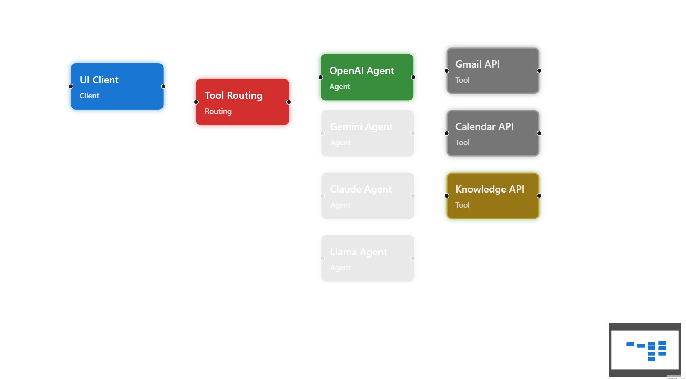

# Multi-Agent AI Playground

A TypeScript and React playground for connecting AI agents, tools, and a web client through a WebSocket hub. The included integrations demonstrate OpenAI, Gmail drafts, Google Calendar, and a knowledge base.



## Features

- A WebSocket hub for routing messages between agents, tools, and the client.
- An OpenAI agent and a tool-routing agent.
- Example Gmail, Google Calendar, and knowledge-base tools.
- A React client for chatting with agents and visualizing connected components.

## Requirements

- Node.js 18 or later and npm.
- An OpenAI API key to use the OpenAI agent.
- Google OAuth credentials and tokens only if using the Gmail or Calendar tools.

## Setup

Install the server and client dependencies:

```sh
npm install
cd client
npm install
cd ..
```

Create a root `.env` file:

```dotenv
OPENAI_API_KEY=your_openai_api_key
CLIENT_ID=your_google_oauth_client_id
CLIENT_SECRET=your_google_oauth_client_secret
```

`CLIENT_ID` and `CLIENT_SECRET` are only needed for Google integrations.

### Optional Google integrations

1. Create a Google Cloud project and enable the Gmail and/or Calendar API.
2. Configure OAuth credentials and add your account as a test user if required.
3. Run `npm run google-auth` and follow the terminal instructions.
4. Save the returned token JSON as `secrets/google-secret.json`.

Google credentials and tokens are local secrets. Do not commit them to GitHub. The `.gitignore` excludes the token file; if it was already pushed, remove it from Git history and revoke/rotate the exposed credentials.

## Run

Start each service in a separate terminal, from the project root:

```sh
npm run start-hub
npm run start-routing
npm run start-agent-openai
```

Start only the tools you need:

```sh
npm run start-tool-knowledge-base
npm run start-tool-gmail
npm run start-tool-gcalendar
```

Gmail and Calendar require the Google setup above. Start the client in another terminal:

```sh
npm run client
```

Open [http://localhost:5173](http://localhost:5173). The hub listens on `ws://localhost:8080`; its HTTP status service listens on port `8081`.

## Project structure

```text
client/                  React + TypeScript web client
src/agents/               AI agents, routing, and tools
src/hub/hub.ts            WebSocket hub and status service
src/types/                Shared message types
src/utils/                Shared utilities and Google authentication
secrets/                  Local-only Google token file (not for Git)
```

## Publish your copy to GitHub

Create an empty repository on GitHub, then run these commands from this folder. Replace the placeholders with your GitHub username and repository name:

```sh
git init -b main
git add .
git commit -m "Initial commit"
git remote add origin https://github.com/<your-username>/<your-repository>.git
git push -u origin main
```

Update the maintainer link below after creating your GitHub repository:

